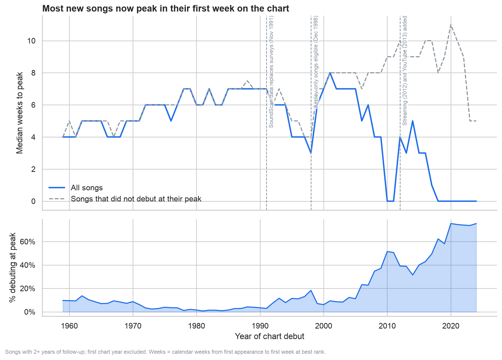
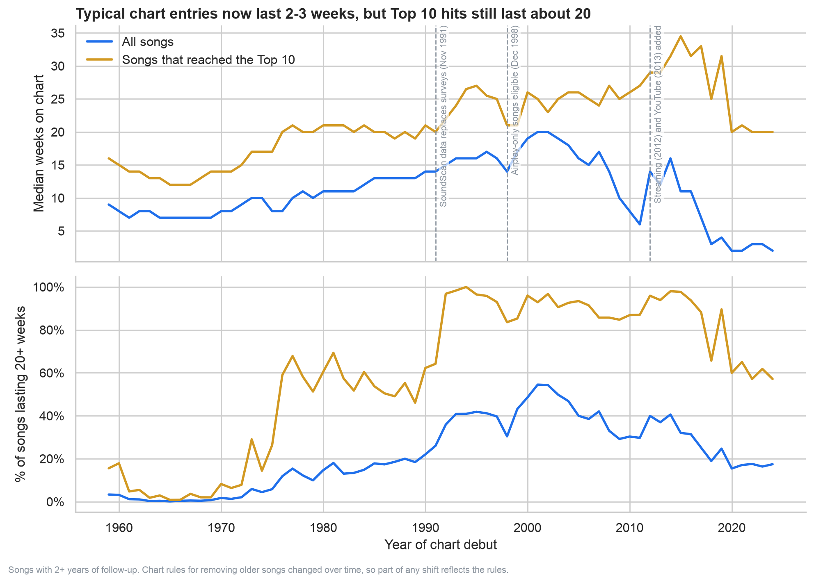
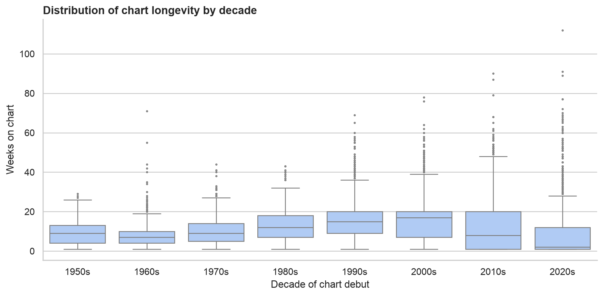
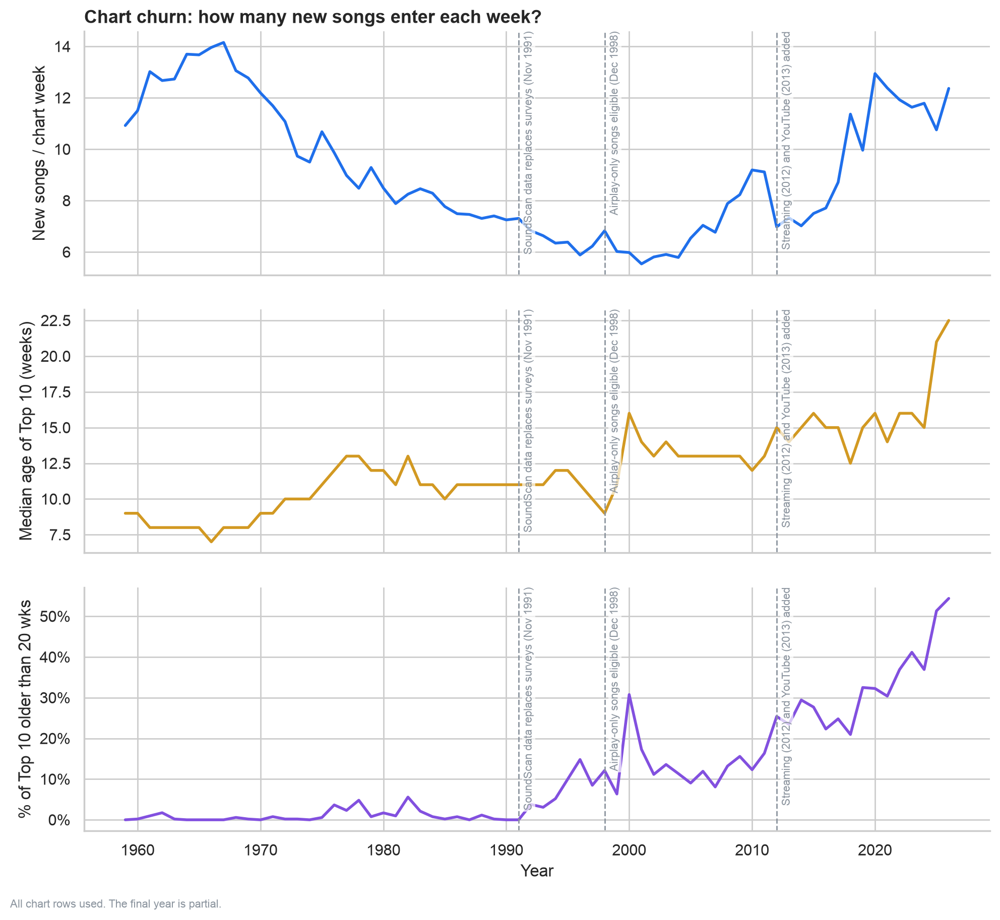
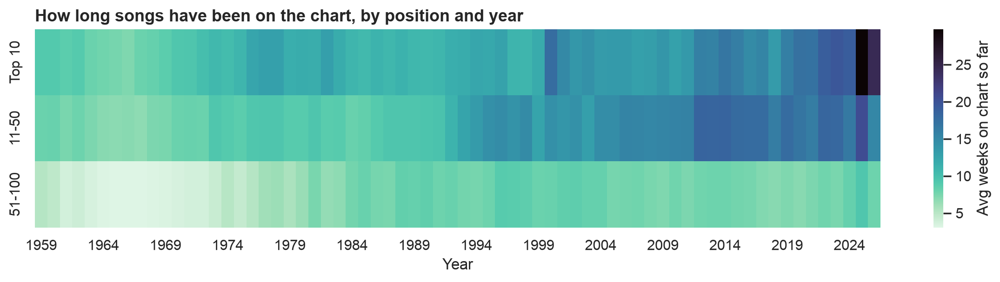

# How do hit songs behave? A Billboard Hot 100 analysis

An exploratory analysis of more than 60 years of the Billboard Hot 100, framed around questions a record label's analytics team might ask about how long hits take to peak, how long they last, and how crowded the chart is at the top.

**Tools:** Python, pandas, matplotlib, seaborn

## Questions

1. How long does a song take to reach its peak position, and has that changed?
2. Are songs staying on the chart longer or shorter than they used to?
3. How much does the chart churn, and are hits becoming more concentrated?

## Key findings

**In short:** the chart now works at two speeds. Most new entries leave within a few weeks, and most songs debut at their peak, while a smaller set of hits stays for months and holds the top positions.

### 1. Time to peak

- **Songs used to build to their peak.** From the 1960s through the 1980s the typical song took about 4 to 7 weeks to peak, and only roughly 1% to 14% of songs debuted at their best position.
- **Now most songs peak immediately.** Since about 2018 the median is 0 weeks, and roughly three quarters of songs debuting in 2020 to 2024 peaked in their first week on the chart.
- Because the overall median sits at 0 once most songs debut at their peak, the dashed line shows the median only for songs that did not.
- I have not tested why. Front-loaded release weeks (for example album drops) and streaming are plausible explanations, but this analysis does not separate them from chart-rule changes.



### 2. Chart longevity

- **Longevity rose, then collapsed.** The median song spent about 7 to 9 weeks on the chart in the 1960s, rising to about 20 weeks for songs debuting around 2001, when roughly 55% lasted 20+ weeks.
- **Today's typical song is short-lived.** For songs debuting in 2020 to 2024 the median is 2 to 3 weeks and only about 16% to 18% reach 20 weeks. This holds after restricting to songs with two years of follow-up, so it is not just a side effect of recent songs still charting.
- **At the same time, the longest runs are longer than ever.** The longest total chart times in the data belong to recent songs: Teddy Swims' "Lose Control" (112 weeks), Glass Animals' "Heat Waves" (91) and The Weeknd's "Blinding Lights" (90).
- **Hits are a different story, but they have shortened too.** Songs that reached the Top 10 have a median of 20 to 21 weeks on the chart in 2020 to 2024, and 57% to 65% lasted 20+ weeks. That is far above the 2 to 3 weeks for all entries, but below the earlier peak. The median for hits was about 12 to 16 weeks in the 1960s, about 20 weeks from the late 1970s through the 1980s, 21 to 27 weeks from the early 1990s through the 2000s, and reached roughly 30 to 35 weeks in the mid-2010s before falling back to about 20 from 2020.
- **A step change around 1991.** The share of Top 10 songs lasting 20+ weeks jumped from roughly 60% to roughly 95% around 1991 to 1992, which coincides with Billboard's switch to SoundScan sales data. Comparisons across that break partly reflect how the chart is measured.
- **Mix versus real change.** Only about 9% to 12% of songs entering the chart in 2020 to 2024 reached the Top 10, so the many short-lived entries dominate the overall median. From 2014 to 2024 the overall median fell from 16 to 2 weeks (almost 90%) while the median for hits fell from 31.5 to 20 (just over a third). A change in the mix of songs explains much of the collapse, but not all of it.
- I have not tested why hits shortened. One candidate is that the Top 10 now includes songs that debut high and fall quickly (for example album-release weeks); chart-rule changes are another. This analysis does not separate them.




### 3. Churn and concentration

- **Churn fell, then rose.** New songs entering per chart week dropped from roughly 14 in the late 1960s to about 6 around 2000, then rebounded to roughly 11 to 13 in the 2020s.
- **The top of the chart is getting older.** The median age of Top 10 entries rose from about 7 to 9 weeks in the 1960s to 15 to 16 weeks in 2022 to 2024, and 21 to 22.5 weeks in 2025 and 2026 (2026 is a partial year). The share of Top 10 rows belonging to songs already past 20 weeks was about 5% or less before 1990, 37% to 41% in 2022 to 2024, and 51% to 54% in 2025 and 2026.
- **Put together,** the chart looks polarised: more new songs cycle through the lower positions while a few long-running songs hold the top spots. These are patterns in the data; the explanations (album-release weeks, streaming accumulation, chart-rule changes) are hypotheses I have not tested.




## Data

- **Source:** [Billboard Hot 100 & more](https://www.kaggle.com/datasets/ludmin/billboard) on Kaggle (`hot100.csv`).
- **Dataset version:** Version 181, accessed October 29, 2026. Kaggle updates this dataset frequently, so results may differ slightly on newer versions.
- **Coverage:** first chart date 1958-07-30, last chart date 2026-10-21 (3,560 chart weeks, with one week missing; see data quality checks).
- **Size:** 355,958 weekly chart rows and 32,702 distinct songs.
- The data is not included in this repository. Download it from Kaggle and place `hot100.csv` in the project folder. Check the dataset's license on Kaggle before redistributing.

## Method

- **Song key:** the dataset has no song ID, so each song is identified by normalised `artist | title` (lowercased, whitespace and Unicode normalised, `&` treated as `and`).
- **Weeks to peak:** calendar weeks from a song's first chart appearance to the first week it reached its best rank.
- **Longevity:** number of distinct weeks a song appeared on the chart.
- **Churn:** new songs entering per chart week, per year.
- **Concentration:** age (in chart weeks so far) of songs holding Top 10 positions.
- **Medians over means,** because a few very long runs skew averages.

## Data quality checks

- The chart is weekly with one exception: one week is missing between 2026-10-07 and 2026-10-21. The effect on results is negligible.
- 8.7% of songs have a gap in their chart run (re-entries, plus the one missing week).
- Artist names are inconsistent in places (featured artists, punctuation). Because the song key only needs to be consistent across weeks, I did not attempt full artist de-duplication. This would matter for artist-level questions.

## Limitations

- **Methodology changes.** Billboard changed how the Hot 100 is calculated several times (for example SoundScan in 1991, airplay-only songs in 1998, streaming in 2012, YouTube in 2013, and later streaming weights and rules for removing older songs). Comparisons across eras partly reflect these rules, not only listener behaviour. Key years are marked on the plots.
- **Right-censoring.** Songs that debuted in the last two years may still be climbing or charting, so Q1 and Q2 only use songs with at least two years of follow-up. A handful of songs accumulate more than 104 total chart weeks (counting re-entries), which does not affect the medians used here. The first chart year is also excluded, since every song looks new in 1958.
- **Partial final year.** 2026 is incomplete, so its values in Q3 should be read cautiously.
- **US-only chart,** and chart position reflects marketing and release strategy as well as listening. Nothing here is causal.

## Run it yourself

```bash
pip install -r requirements.txt
python3 main.py
```

Plots are saved to `figures/`. The script also prints data quality checks and summary tables.

## Repository structure

```
main.py             analysis and plots
requirements.txt    dependencies
figures/            generated plots
```

## Possible next steps

- Compare streaming, radio and sales charts (`streaming.csv`, `radio.csv`, `digital.csv` in the same dataset).
- Normalise artist names to study artist-level questions such as one-hit wonders.
- Join audio features to ask whether a song's sound relates to how long it charts.
